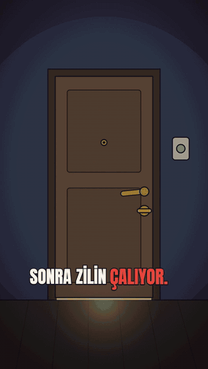
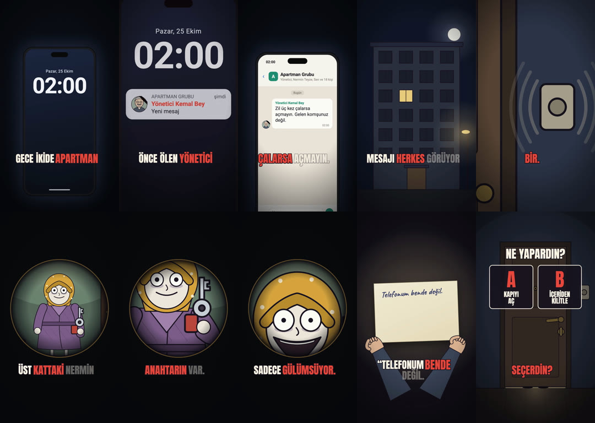
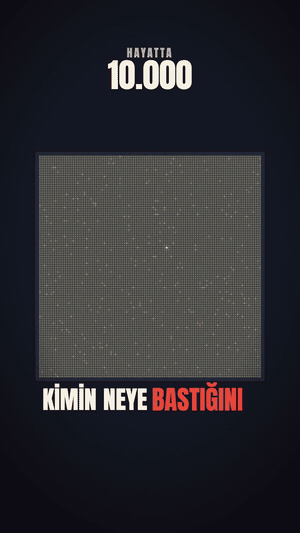
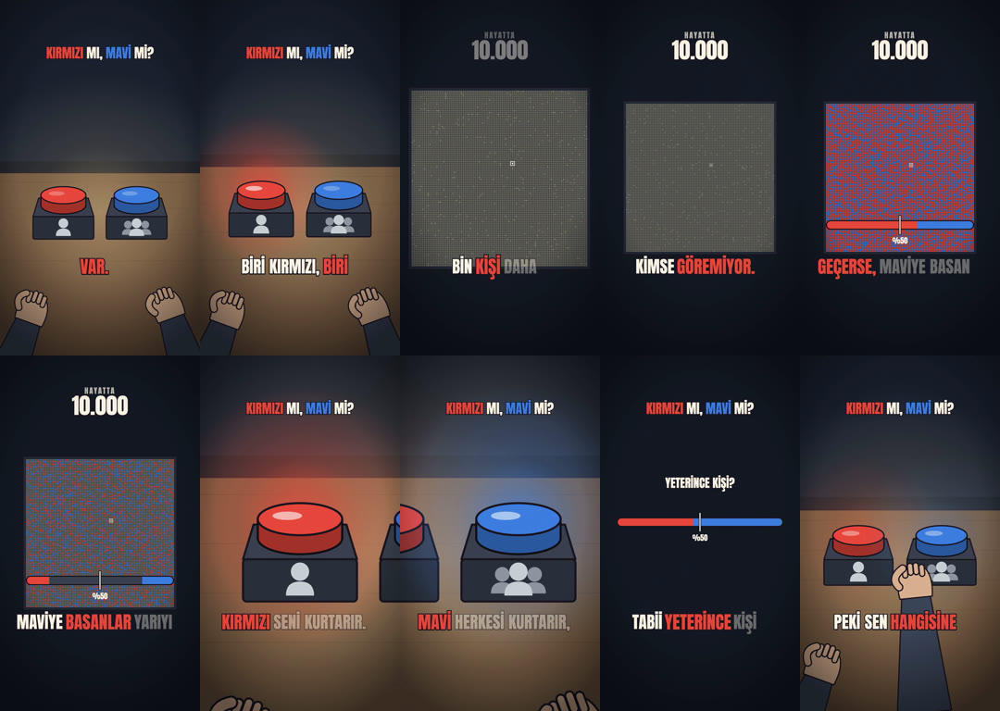
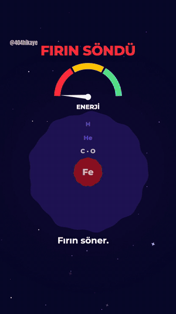
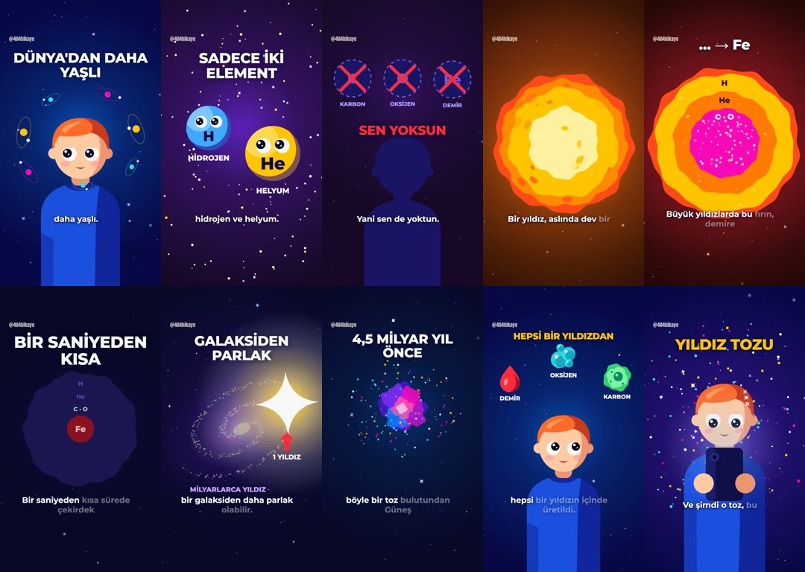

# claude-motion-kit

Story Reels (vertical 1080×1920) in any language, made in code: a script is voiced, the voice's word times drive a
drawn Remotion video. The concepts here (in Turkish): interactive horror stories that end on an A/B vote, and loop
dilemmas.
Three examples it makes (all in `examples/`, with sound):

**Apartman** ([apartment-p1-tr.mp4](examples/apartment-p1-tr.mp4), 69 s): part 1 of an interactive horror story that ends on an A/B vote.

<p>
  
  
</p>

**Düğmeler** ([buttons-p1-tr.mp4](examples/buttons-p1-tr.mp4), 28 s): a loop dilemma whose last sentence runs into its first.

<p>
  
  
</p>

**Sen yıldız tozusun** ([stardust-p1-tr.mp4](examples/stardust-p1-tr.mp4), 69 s): an explainer in the `glow-flat` style, on where your atoms came from.

<p>
  
  
</p>

## Layout

| path | what | tech |
|---|---|---|
| `motion` | the one entry point: `voice`, `check`, `sfx`, `still`, `preview`, `render`, `cover`, `image`, `studio` | zsh |
| `stories/<story>/part<N>/` | content: `script.txt` | text |
| `modules/narration/` | script → voice + word times (`tts.py`); did the voice say the script (`check.py`) | Python: edge-tts or ElevenLabs, faster-whisper |
| `modules/sound/` | the sound library, synthesised (`sfx.sh`) | ffmpeg |
| `modules/video/` | the drawn library (`src/library`), the example (`src/examples`), your stories (`src/stories`) | TypeScript, Remotion 4 |
| `media/` | what the modules hand each other (narration, sounds): Remotion's public dir | files |
| `concept/` | what the videos are: the concepts, the format guide, the example | Markdown |
| `CLAUDE.md` | how to work on this repo | Markdown |
| `examples/`, `docs/` | the example videos, and their previews and frames for this page | media |

The modules only meet through files in `media/`; any one can change without the others knowing.

## Setup

Needs Node 20.19+ (or 22.13+), Python 3.9+, ffmpeg on the PATH, zsh, and the internet: the voice comes from Microsoft's
Edge TTS service, and the fonts from Google Fonts at render time.

```
cd modules/video && npm install && cd ../..
python3 -m venv .venv && .venv/bin/pip install -r modules/narration/requirements.txt
echo "ELEVENLABS_API_KEY=…" > .env  # only for ElevenLabs voices (edge-tts needs no key)
./motion sfx                       # the sound library → media/sfx/
./motion render apartman 1         # the example → out/apartman-p1.mp4 (Remotion downloads its Chrome on the first render)
```

## A new story part

```
stories/<story>/part1/script.txt                          write it
./motion voice <story> 1 && ./motion check <story> 1      voice it, then check what the voice said
modules/video/src/stories/<story>/<Story>P1.story.tsx     draw it (it registers itself; see CLAUDE.md)
./motion preview <story> 1 && ./motion render <story> 1   look, then render
```

Your own stories stay on your machine (see .gitignore); only the example is in the repo.

Remotion is free for individuals and companies of up to 3 people; its licence is in
`modules/video/node_modules/remotion/LICENSE.md`.
